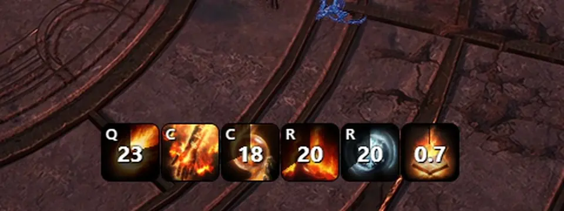
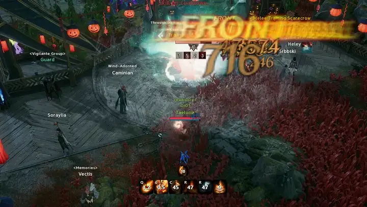
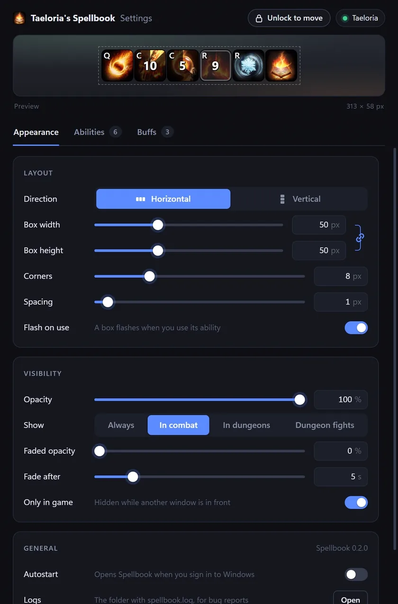

# Taeloria's Spellbook

Cooldown and buff overlay for AION 2 Global. Reads the game's network traffic through Npcap, like the DPS meters, and never touches the game client.



## Features

- Your cooldowns in a bar you can put anywhere
- Horizontal or vertical, with your pick of box size, corners, spacing and opacity
- Choose which abilities show, and drag them into order
- Your keybind on each ability
- A flash when you use an ability, and a gold shine when it's ready again
- Show it always, only in combat, only in dungeons, or only in dungeon fights
- Hides when another window is in front of the game
- Tracks buffs on you as boxes or bars, with a red outline when one is about to run out
- A separate buff list for each class
- Names and icons for buffs from your party
- Starts with Windows if you want, and updates itself

## Install

1. Install [Npcap](https://npcap.com/#download).
2. Download `Spellbook_x.y.z_x64-setup.exe` from the [latest release](https://github.com/taylorjohannsen/taelorias-spellbook-aion2-cooldown-tracker/releases/latest) and run it. Windows may warn that it's from an unknown publisher: click More info, then Run anyway.

Spellbook updates itself when it starts. If you had it from when it was called tjcd, the update moves your settings over and removes tjcd.

## Use

Start it before logging in, or change zone or use a couple of skills once you're in.



Open the settings with the gear in the bottom-left corner of your screen, which shows while the game is in front, or from Spellbook's tray icon. To move the bar or the buffs window, click Unlock at the top of the settings, drag them where you want, then lock them again.



The game doesn't share its keybinds, so set each ability's key in the Abilities tab. The ✦ next to it turns on the gold shine. Buffs to track are picked in the Buffs tab.

## Build

Needs [Npcap](https://npcap.com/#download) and [Rust](https://rustup.rs).

```sh
cargo run --release
```

`--demo` shows fake casts without the game. `--trace` logs every cast to `%APPDATA%\spellbook\spellbook.log`.

## Disclaimer

Spellbook isn't affiliated with NCSOFT. It only reads network traffic, like the DPS meters, and never touches the game. Use it at your own risk.

## Credits

Packet layouts from [RATmeter](https://github.com/Kuroukihime/AIon2-Dps-Meter) and [aion2-dps-meter](https://github.com/cyberbadger6969/aion2-dps-meter).

Skill and buff names and icons come from NC's public character pages: your own character's, and once a week one character of each class on your server, to name other players' buffs.

## License

MIT, see [LICENSE](LICENSE).
