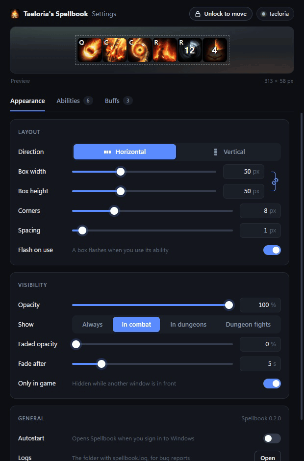

# tjcd

Cooldown and buff overlay for AION 2 Global. Reads the game's network traffic through Npcap, like the DPS meters, and never touches the game client.


## Install

1. Install [Npcap](https://npcap.com/#download).
2. Download `tjcd_x.y.z_x64-setup.exe` from the [latest release](https://github.com/taylorjohannsen/tjcd/releases/latest) and run it. Windows may warn that it's from an unknown publisher: click More info, then Run anyway.

tjcd updates itself when it starts.

## Use

Start it before logging in, or change zone or use a couple of skills once you're in.


Open the settings with the gear in the bottom-left corner of your screen, which shows while the game is in front, or from tjcd's tray icon. To move the bar or the buffs window, click Unlock at the top of the settings, drag them where you want, then lock them again.



The settings change the bar's direction, the size and corners of each box, which abilities show in what order, and whether the bar shows only in combat or in dungeons. The game doesn't share its keybinds, so each ability's key is set there too, and the ✦ next to it makes the ability shine gold when it comes off cooldown. The Buffs tab tracks buffs on you, as boxes or bars, in a window of their own, with a list for each class. The overlay hides while another window is in front of the game, unless that's turned off.

## Build

Needs [Npcap](https://npcap.com/#download) and [Rust](https://rustup.rs).

```sh
cargo run --release
```

`--demo` shows fake casts without the game. `--trace` logs every cast to `%APPDATA%\tjcd\tjcd.log`.

## Disclaimer

tjcd isn't affiliated with NCSOFT. It only reads network traffic, like the DPS meters, and never touches the game. Use it at your own risk.

## Credits

Packet layouts from [RATmeter](https://github.com/Kuroukihime/AIon2-Dps-Meter) and [aion2-dps-meter](https://github.com/cyberbadger6969/aion2-dps-meter).

Skill and buff names and icons come from NC's public character pages: your own character's, and once a week one character of each class on your server, to name other players' buffs.

## License

MIT, see [LICENSE](LICENSE).
